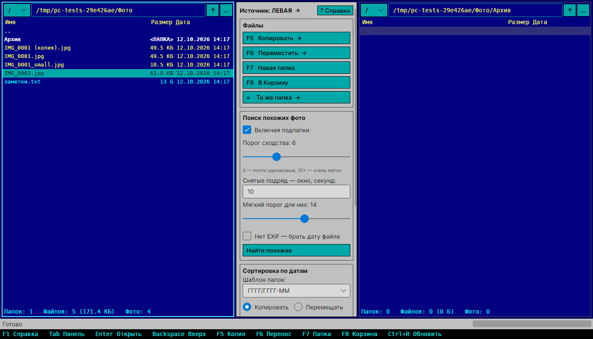
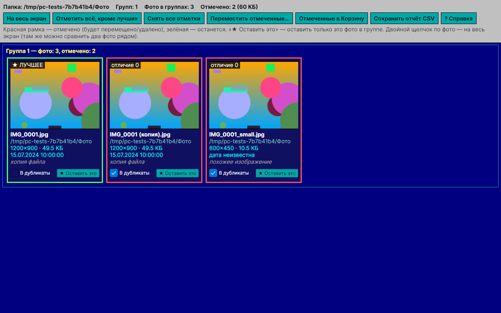
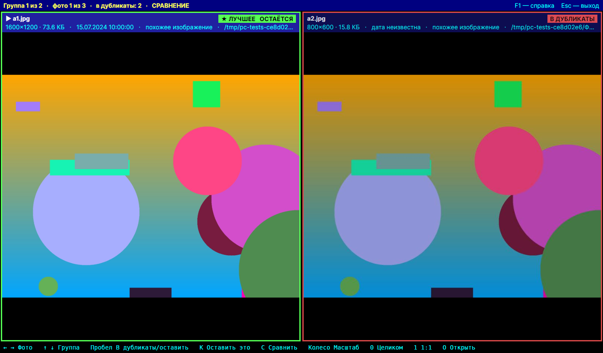

# Photo Commander

Двухпанельный файловый менеджер в стиле Norton Commander для разбора фотографий:
поиск одинаковых и похожих фото через OpenCV и раскладка по папкам с датами.

Написан на C# и [Avalonia](https://avaloniaui.net/) (.NET 10), работает в **Windows** и **Linux**.



## Как пользоваться — коротко

1. В **левой** панели откройте папку с фото. Панель с яркой рамкой — источник, вторая — куда.
2. Нажмите **«Найти похожие»**. Будут найдены копии, уменьшенные/пересжатые версии и серии кадров.
3. В окне результатов: **красная** рамка — фото уйдёт в дубликаты, **зелёная** — останется. Лучшая копия выбрана сама.
4. **Двойной щелчок** по фото — просмотр на весь экран: можно увеличить и сравнить два кадра рядом (клавиша `C`).
5. **«Переместить отмеченные…» → «Да»** — дубликаты переедут в папку `_duplicates`. Ничего не удаляется насовсем.
6. Разложить по датам: во второй панели откройте папку назначения, выберите шаблон и нажмите **«Разложить по датам»**.

Справка в программе — клавиша `F1` или кнопка «? Справка».

## Запуск

### Готовая программа
В разделе **Releases** (или во вкладке **Actions** → последняя сборка → *Artifacts*) лежат готовые файлы:
`PhotoCommander-win-x64` и `PhotoCommander-linux-x64`. Устанавливать .NET для них не нужно.

### Из исходников — Windows
1. Установите .NET 10 SDK (один раз):
   ```
   winget install Microsoft.DotNet.SDK.10
   ```
   После этого **закройте и заново откройте** командную строку.
2. Дважды щёлкните `run.bat`. Первый запуск дольше: скачиваются пакеты.

Отдельный `PhotoCommander.exe`, который работает без .NET, собирает `publish.bat` (появится в `publish\win-x64`).

Проект открывается в Visual Studio 2022/2026 или Rider: `PhotoCommander.sln` → F5.

### Из исходников — Linux
```bash
sudo apt install dotnet-sdk-10.0     # Ubuntu 24.04+; для других систем см. https://dot.net
./run.sh                             # запуск
./publish.sh                         # один файл в publish/linux-x64
./publish.sh win-x64                 # или собрать .exe для Windows
```

## Что умеет

### Файловые панели (в стиле Norton Commander)
* Две синие панели: слева и справа. Активная (с яркой рамкой) — источник, вторая — куда.
* Выбор диска, строка пути, кнопка «…» для выбора папки, «↑» на уровень выше.
* Папки выделены белым, фото жёлтым. Внизу панели: сколько папок, файлов и фото и какой у них размер.
* Можно выделять несколько файлов с `Ctrl` или `Shift`, быстро искать по первым буквам имени и открывать файл двойным щелчком.

### Файловые операции
* `F5` — копировать, `F6` — переместить в другую панель.
* `F7` — новая папка.
* `F8` / `Del` — в Корзину (можно восстановить).
* «Та же папка» — открыть во второй панели ту же папку.
* `Tab` — переключить панель, `Enter` — открыть, `Backspace` — вверх, `Ctrl+R` — обновить.

### Поиск похожих фото (OpenCV)
* Точные копии по MD5.
* Похожие фото с другим размером, сжатием или форматом по перцептивному хэшу. Порог задаётся ползунком 0–20.
* Снятые подряд (по дате EXIF в пределах N секунд) сравниваются с более мягким порогом, так находятся серии кадров.
* Можно включать подпапки и брать дату файла, если в фото нет EXIF.
* Окно результатов: группы с превью. В каждой группе автоматически выбрана лучшая копия
  (наибольшее разрешение, затем размер файла, при равенстве — более короткое имя, обычно это оригинал).
  * Красная рамка — фото пойдёт в дубликаты, зелёная — останется. Есть кнопка «★ Оставить это».
  * Отмеченные можно переместить (в `_duplicates` с сохранением подпапок или в любую папку) или отправить в Корзину.
  * Предупреждение, если в группе отмечены все фото.
  * Отчёт можно сохранить в CSV.



### Просмотр на весь экран
Двойной щелчок по фото в окне результатов (или кнопка «На весь экран»).

| Клавиша | Действие |
|---|---|
| `←` `→` | предыдущее / следующее фото (на краю группы — в соседнюю группу) |
| `↑` `↓`, `PgUp` `PgDn` | предыдущая / следующая группа |
| `Пробел` | в дубликаты / оставить |
| `K` или `Enter` | «★ Оставить это» — остальные фото группы в дубликаты |
| `C` | сравнить два фото рядом; `Tab` или щелчок — какая половина активна |
| колесо мыши, `+` `−` | масштаб (в режиме сравнения — у обеих половин сразу) |
| перетаскивание | сдвиг увеличенного фото |
| `0` / `1` / двойной щелчок | целиком / 1:1 / переключить |
| `O` | открыть в другой программе |
| `F1` | подсказка по клавишам, `F11` — окно / весь экран, `Esc` — выход |

Отметки, сделанные здесь, сразу видны в окне результатов.



### Сортировка по датам
* Раскладывает фото по папкам с датой съёмки: `2024\2024-07`, `2024\07`, `2024\2024-07-15` или `2024-07-15`.
* Можно копировать или перемещать, учитывать подпапки и пропускать дубликаты (тогда раскладываются только лучшие копии).
* Файлы с одинаковыми именами не затираются: добавляется `_1`, `_2` …

### Просмотр
* Превью выбранного фото с учётом поворота из EXIF, разрешение, размер и дата съёмки.

### Прочее
* Тяжёлые операции идут в фоне с прогрессом и кнопкой «Отмена».
* Пути с кириллицей поддерживаются.
* Форматы: JPG, PNG, BMP, TIFF, WebP.
* Корзина: в Windows — системная, в Linux — стандартная `~/.local/share/Trash` (видна в файловом менеджере).

## Python-версия
`python/photo_dedup.py` — тот же алгоритм для командной строки:
```
pip install opencv-python numpy pillow
python python/photo_dedup.py "C:\Фото"                       # только отчёт
python python/photo_dedup.py "C:\Фото" --move-dups           # дубликаты в _duplicates
python python/photo_dedup.py "C:\Фото" --sort-to "D:\Сорт"   # уникальные фото по папкам ГГГГ/ГГГГ-ММ
```
Все параметры: `python python/photo_dedup.py --help`.

## Структура репозитория
```
PhotoCommander.sln
src/PhotoCommander/            приложение (Avalonia)
  Controls/FilePane            файловая панель
  Controls/ZoomImage           картинка с масштабом и сдвигом
  Views/                       окно дубликатов, просмотр на весь экран, справка, диалоги
  Services/                    поиск дубликатов, EXIF, превью, сортировка, файловые операции
tests/PhotoCommander.Tests/    тесты: логика + интерфейс в headless-режиме (со скриншотами)
python/photo_dedup.py          консольная версия
run.bat / run.sh               запуск из исходников
publish.bat / publish.sh       сборка одного исполняемого файла
.github/workflows/build.yml    CI: тесты в Windows и Linux, готовые сборки
```

## Тесты
```
dotnet test
```
Проверяются поиск дубликатов (копии, уменьшенные и перекодированные версии, серии кадров),
чтение EXIF, поворот превью, сортировка по датам, Корзина, а также окна программы:
панели, `Tab`, `F5`, `F7`, `F1`, поиск похожих, «★ Оставить это», перенос в `_duplicates`, CSV,
просмотр на весь экран (листание, отметки, сравнение, общий масштаб).
Скриншоты окон сохраняются в `tests/PhotoCommander.Tests/bin/<конфигурация>/net10.0/screenshots`.
